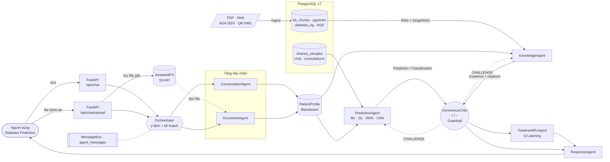
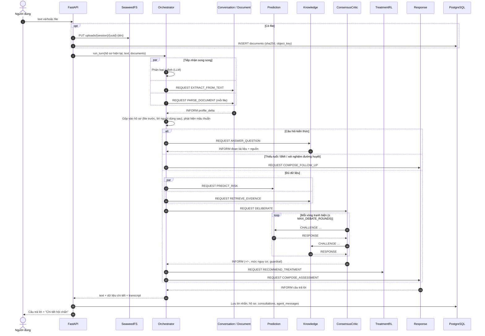

# HỆ THỐNG CHATBOT ĐA TÁC TỬ DỰ ĐOÁN ĐÁI THÁO ĐƯỜNG
## Diabetes Prediction — Multi-Agent Clinical Chatbot: Sàng lọc, Phân tầng Nguy cơ & Gợi ý Can thiệp

* **Môn học:** Phát triển hệ thống thông minh (Intelligent System Development)
* **Sinh viên thực hiện:** Nguyễn Tự Kiên (B23DCCN465) — CT01 / Nhóm 07
* **Giao diện:** Web/Desktop Chatbot [Diabetes Prediction](https://github.com/ngtukien/AStarCare) (React + Tauri), không cần đăng nhập

Người dùng có thể:
1. **Nhập văn bản tự do** — *"Mẹ tôi năm nay 61, nặng 68 ký cao 1m52, sáng nay thử đường máu lúc chưa ăn được 6,4, có uống thuốc huyết áp"*.
2. **Tải lên bệnh án** — PDF (kể cả PDF scan), ảnh chụp phiếu xét nghiệm, DOCX, CSV chuỗi đo đường huyết. Có thể gửi nhiều file trong một tin nhắn.
3. **Hỏi kiến thức** — *"HbA1c bao nhiêu thì là tiền tiểu đường?"*
4. **Nói bằng giọng** — ghi âm, Gemini chép lại thành văn bản.

Hệ thống trả về: mức nguy cơ, các bằng chứng đồng thuận (+) và điểm mâu thuẫn (−) sau phiên tranh biện giữa các tác tử, cảnh báo an toàn, khuyến cáo theo ADA 2024 / QĐ 5481/QĐ-BYT có trích dẫn nguồn, và gợi ý bước can thiệp.

> ⚠️ Hệ thống phục vụ học tập/nghiên cứu, **không thay thế chẩn đoán của bác sĩ**. Mọi câu trả lời đánh giá đều kèm lời nhắc này; hệ thống không đưa liều thuốc cụ thể.

---

## 1. Mô hình Multi-Agent

### 1.1. Ánh xạ từ sơ đồ của thầy

| Khối trên bảng | Hiện thực |
|---|---|
| **DB** → ML / DL → *Prediction / Classification* | `PredictionAgent`: **ML** (Gradient Boosting) + **DL** (MLP PyTorch) huấn luyện từ bảng `nhanes_samples` trong **PostgreSQL** (dữ liệu thật NHANES, 20.646 người); RNN khi có chuỗi đo glucose; CNN khi có đặc trưng ảnh đáy mắt |
| **PDF / Web** → **KB** | `scripts/ingest_kb.py`: bản gốc lưu lên **SeaweedFS** → chia đoạn → embedding vào **pgvector**; bộ ba tri thức vào **Apache AGE** |
| **KB** → **RAG** → **Agent** | `KnowledgeAgent`: hybrid search (vector + full-text) + GraphRAG (Cypher trên AGE) + đối chiếu tiêu chuẩn chẩn đoán ADA |
| **Vòng tròn lớn (+ / −)** | `ConsensusCriticAgent`: tranh biện nhiều vòng với hai nhánh, liệt kê (+) / (−), Safety Guardrail |

Bổ sung so với sơ đồ: tầng **tiếp nhận** (text + file), tầng **hội thoại** (hỏi lại khi thiếu dữ liệu), tác tử **gợi ý can thiệp** (Q-Learning) và tác tử **phản hồi** (LLM viết câu trả lời có trích dẫn).

### 1.2. Mô hình tổ chức

- **Supervisor + Blackboard.** `Orchestrator` nhận mỗi lượt chat, phân loại ý định và **lập kế hoạch động**: câu hỏi kiến thức chỉ đi nhánh RAG; thiếu dữ liệu thì hỏi lại; câu hỏi tiếp nối thì trả lời từ bộ nhớ; có dữ liệu mới thì chạy hai nhánh song song rồi đưa vào hội đồng. Trạng thái chung là `PatientProfile`, tích lũy qua nhiều lượt chat.
- **Bộ nhớ hai tầng** (đọc từ PostgreSQL mỗi lượt):
  - *Bộ nhớ có cấu trúc* — `PatientProfile` của phiên: mọi chỉ số đã khai, kèm nguồn.
  - *Bộ nhớ hội thoại* — 10 tin nhắn gần nhất và kết quả hội chẩn gần nhất. Được đưa cho bộ phân loại ý định (hiểu câu "vậy tại sao…"), cho ConversationAgent (hiểu câu trả lời cụt "62" sau khi bot hỏi tuổi) và cho ResponseAgent.
  - Ý định `FOLLOW_UP` ("tôi cao bao nhiêu?", "tại sao nguy cơ cao?") được trả lời từ hai tầng bộ nhớ, **không chạy lại hội đồng** khi không có dữ liệu mới.
- **Giao tiếp bằng thông điệp, không gọi hàm trực tiếp.** Mọi tác tử kế thừa `BaseAgent`, tự đăng ký vào `MessageBus` và chỉ nhận việc qua `handle(AgentMessage)`. Thông điệp có *performative* theo tinh thần FIPA-ACL: `REQUEST`, `INFORM`, `CHALLENGE`, `RESPONSE`, `FAILURE`. Bus định tuyến theo `receiver` và ghi toàn bộ hội thoại giữa các tác tử (audit trail) vào bảng `agent_messages`.
- **Tranh biện nhiều vòng.** `ConsensusCriticAgent` không chỉ tổng hợp: khi phát hiện mâu thuẫn, nó gửi `CHALLENGE` qua bus tới tác tử liên quan, nhận `RESPONSE` và cập nhật kết luận. Phản hồi ở vòng trước có thể mở ra câu hỏi ở vòng sau (tối đa `MAX_DEBATE_ROUNDS`).
- **Dữ liệu có nguồn gốc.** Mỗi trường trong hồ sơ lưu nguồn (`text`, `file:<tên>`, `derived`, `form`), độ tin cậy, đoạn trích làm bằng chứng và cờ cảnh báo (`unit_inferred`, `fasting_unclear`). Hệ thống **không tự điền giá trị mặc định** cho chỉ số lâm sàng; khi hai nguồn mâu thuẫn, hội đồng báo (−) để người dùng xác nhận.
- **Chịu lỗi.** Một tác tử lỗi trả `FAILURE` thay vì làm sập cả lượt; LLM lỗi hoặc quá tải thì chuyển sang model dự phòng, rồi tới nhánh luật/regex.

### 1.3. Danh sách tác tử

| Tác tử | Nhận (`msg_type`) | Vai trò | Công nghệ |
|---|---|---|---|
| **Orchestrator** | — (khởi tạo hội thoại) | Phân loại ý định, lập kế hoạch, điều phối song song | LLM structured output + luật dự phòng |
| **ConversationAgent** | `EXTRACT_FROM_TEXT` | Bóc tách chỉ số, yếu tố nguy cơ từ tin nhắn tự do | LLM structured output; dự phòng regex tiếng Việt |
| **DocumentAgent** | `PARSE_DOCUMENT` | Đọc file từ SeaweedFS → trích chỉ số → quy đổi đơn vị (mmol/L → mg/dL, mmol/mol → %, µmol/L → mg/dL) | PyMuPDF, python-docx, pandas, LLM vision (ảnh / PDF scan), Tesseract khi không có LLM |
| **PredictionAgent** | `PREDICT_RISK`, `CHALLENGE_ML_VS_LABS`, `CHALLENGE_DATA_QUALITY`, `CHALLENGE_MODEL_DISAGREEMENT` | Hai mô hình ML + DL cho xác suất nguy cơ theo yếu tố nguy cơ (lấy trung bình) + giải thích đặc trưng; chỉ số CGM (TIR/TBR/CV); bảo vệ, nhượng bộ hoặc giải trình khi bị chất vấn | scikit-learn HistGradientBoosting, PyTorch MLP, RNN (NumPy) |
| **KnowledgeAgent** | `RETRIEVE_EVIDENCE`, `ANSWER_QUESTION`, `CHALLENGE_VERIFY_CRITERIA`, `CHALLENGE_SCREENING_PLAN` | Đối chiếu xét nghiệm với ngưỡng ADA; hybrid RAG; GraphRAG; trả trích dẫn | pgvector, Apache AGE, fastembed |
| **ConsensusCriticAgent** | `DELIBERATE` | Tranh biện, liệt kê (+)/(−), phân tầng nguy cơ, Safety Guardrail | Luật lâm sàng |
| **TreatmentRLAgent** | `RECOMMEND_TREATMENT` | Chọn bước can thiệp bằng Q-Learning, bị ràng buộc bởi kết luận hội đồng và chống chỉ định trong KG | Q-Learning (MDP 24 trạng thái × 4 hành động) |
| **ResponseAgent** | `COMPOSE_*` | Viết câu trả lời chỉ dựa trên kết quả các tác tử, có trích dẫn | LLM; dự phòng mẫu câu |

### 1.4. Giao thức tranh biện của hội đồng

| Vấn đề Critic phát hiện | Chất vấn | Phản hồi | Ảnh hưởng tới kết luận |
|---|---|---|---|
| Dữ liệu thật < 35% đặc trưng của mô hình | `PredictionAgent` · `CHALLENGE_DATA_QUALITY` | Hạ độ tin cậy, liệt kê đặc trưng còn thiếu | (−) chất lượng dữ liệu |
| ML và DL lệch nhau ≥ 15 điểm % | `PredictionAgent` · `CHALLENGE_MODEL_DISAGREEMENT` | Chỉ ra đặc trưng mà hai mô hình đánh giá khác nhau nhất, dùng trung bình, hạ độ tin cậy | (−) — thường báo hiệu hồ sơ bất thường / ngoài vùng dữ liệu đã học (ví dụ BMI 42 nhưng vòng eo 80 cm) |
| ML ≥ 30% nhưng xét nghiệm bình thường | `PredictionAgent` · `CHALLENGE_ML_VS_LABS` | Giữ quan điểm "nguy cơ dài hạn", thừa nhận xét nghiệm là căn cứ chẩn đoán | (−) + **mở vòng 2** |
| *(vòng 2)* ML giữ quan điểm nguy cơ dài hạn | `KnowledgeAgent` · `CHALLENGE_SCREENING_PLAN` | Lịch tầm soát theo ADA cho người có yếu tố nguy cơ | (+) kế hoạch theo dõi thống nhất |
| ML < 15% nhưng xét nghiệm ở ngưỡng ĐTĐ | `PredictionAgent` · `CHALLENGE_ML_VS_LABS` | Nhượng bộ cho xét nghiệm | (−) |
| Xét nghiệm ở ngưỡng ĐTĐ | `KnowledgeAgent` · `CHALLENGE_VERIFY_CRITERIA` | Kiểm tra quy tắc "2 kết quả bất thường" của ADA, kèm trích dẫn | Kết luận "đủ tiêu chí" hoặc "cần xét nghiệm lại" |

Ngoài ra Critic tự liệt kê: chỉ số mâu thuẫn giữa các nguồn, đơn vị phải đoán, glucose chưa rõ đo lúc đói, TBR > 4% trong chuỗi CGM. **Safety Guardrail** luôn được ưu tiên: glucose ≥ 600 (cấp cứu), glucose ≥ 300 hoặc HbA1c ≥ 10% (khám sớm), glucose < 54 (hạ đường huyết mức 2), nhóm nguy cơ đỏ (BMI ≥ 25 + tăng huyết áp + tiền sử gia đình/tim mạch).

Phân tầng cuối cùng lấy **xét nghiệm làm căn cứ chính** (ngưỡng ADA), ML bổ sung nguy cơ dài hạn khi xét nghiệm bình thường: *Rất cao* (ngưỡng ĐTĐ) · *Cao* (tiền ĐTĐ hoặc ML ≥ 30%) · *Trung bình* (ML 15–30%) · *Thấp*.

### 1.5. Sơ đồ kiến trúc



---

## 2. Kiến trúc thư mục

```text
MultiAgent/
├── app.py                         FastAPI: khởi tạo DB, nạp tác tử, mount route + giao diện
├── docker-compose.yml             postgres (AGE + pgvector), seaweedfs, backend (profile "app")
├── Dockerfile                     Image backend
├── requirements.txt · .env.example · .gitignore · .dockerignore
│
├── docker/
│   ├── postgres/Dockerfile        apache/age:release_PG17_1.6.0 + postgresql-17-pgvector
│   ├── postgres/init.sql          CREATE EXTENSION vector, age, unaccent, pg_trgm; tạo graph diabetes_kg
│   └── seaweedfs/s3.json          Khóa truy cập S3 (môi trường dev)
│
├── src/
│   ├── config.py                  Cấu hình từ biến môi trường / .env
│   ├── agents/
│   │   ├── orchestrator.py        Phân loại ý định, kế hoạch động, điều phối song song
│   │   ├── conversation_agent.py  Text → PatientProfile
│   │   ├── document_agent.py      File bệnh án → PatientProfile
│   │   ├── prediction_agent.py    Nhánh DB → ML/DL, trả lời CHALLENGE
│   │   ├── knowledge_agent.py     Nhánh KB → RAG, trả lời CHALLENGE
│   │   ├── consensus_critic_agent.py  Vòng tròn (+/−), tranh biện nhiều vòng, guardrail
│   │   ├── treatment_rl_agent.py  Q-Learning có ràng buộc an toàn
│   │   └── response_agent.py      Câu trả lời grounded + mẫu dự phòng
│   ├── communication/
│   │   └── message_bus.py         AgentMessage, BaseAgent, MessageBus (định tuyến + audit trail)
│   ├── schemas/
│   │   └── patient_profile.py     Blackboard: giá trị + nguồn + độ tin cậy + cờ; phát hiện mâu thuẫn
│   ├── llm/
│   │   ├── client.py              Gemini / Claude, structured output, model dự phòng, timeout
│   │   └── prompts.py             Prompt + schema trích xuất, ý định, bộ ba tri thức
│   ├── document_processing/
│   │   ├── loaders.py             PDF / PDF scan / ảnh / DOCX / CSV; OCR Tesseract
│   │   ├── lab_extractor.py       Regex tiếng Việt cho chỉ số xét nghiệm và yếu tố nguy cơ
│   │   └── unit_normalizer.py     Quy đổi đơn vị, đánh dấu đơn vị phải đoán
│   ├── knowledge/
│   │   ├── ingest.py              PDF/Web/MD → SeaweedFS → chunk → pgvector; bộ ba → AGE
│   │   ├── embedder.py            fastembed đa ngôn ngữ (dự phòng: hashing offline)
│   │   └── clinical_criteria.py   Ngưỡng ADA, quy tắc xác nhận, ánh xạ hồ sơ → node KG
│   ├── models/
│   │   ├── datasets.py            Mô tả bộ dữ liệu NHANES / VN, ánh xạ hồ sơ → đặc trưng, tăng cường che đặc trưng
│   │   ├── tabular_ml.py          ML: Gradient Boosting + giải thích bằng che đặc trưng (occlusion)
│   │   ├── deep_mlp.py            DL: MLP 3 lớp ẩn (PyTorch), có cờ thiếu dữ liệu cho từng đặc trưng
│   │   ├── rnn_temporal.py        Chỉ số CGM + RNN
│   │   ├── cnn_vision.py          CNN võng mạc (minh họa)
│   │   ├── deep_graph.py          GCN bệnh đồng mắc (minh họa)
│   │   └── qlearning_treatment.py Q-Learning
│   ├── storage/
│   │   ├── db.py                  Engine SQLAlchemy, init_db() tạo extension/bảng/index
│   │   ├── models.py              ORM: chat, documents, consultations, agent_messages, kb_*, kg_*
│   │   ├── vector_store.py        Hybrid search pgvector + full-text, Reciprocal Rank Fusion
│   │   ├── graph_store.py         AgeGraphStore (Cypher) | SqlGraphStore (WITH RECURSIVE)
│   │   └── object_storage.py      S3Storage (SeaweedFS/AWS S3) | LocalStorage
│   ├── api/
│   │   ├── routes_chat.py         /api/chat, /api/chat/upload, /api/documents/{id}/content
│   │   ├── routes_session.py      Phiên chat, feedback, xóa hồ sơ
│   │   ├── routes_system.py       /health, /api/system, KB, form đánh giá, Q-table, transcribe
│   │   └── deps.py
│   └── data_preprocessing.py      Sinh hình cho tiểu luận
│
├── scripts/
│   ├── fetch_nhanes.py            Tải NHANES 2011–2018 từ CDC, dựng nhãn ĐTĐ bằng xét nghiệm
│   ├── train_model.py             Nạp CSV vào Postgres, huấn luyện và so sánh ML / DL / hồi quy logistic
│   ├── ingest_kb.py               Nạp Knowledge Base (thư mục, URL, --llm-triples)
│   └── chat_cli.py                Chat với hội đồng trên terminal (--trace in luồng thông điệp)
│
├── data/
│   ├── vietnam_diabetes_dataset.csv
│   ├── nhanes/nhanes_diabetes.csv Bộ dữ liệu NHANES đã xử lý (raw/ là file XPT gốc)
│   ├── models/                    {nhanes,vn}_gbdt.joblib, {nhanes,vn}_mlp.pt, metrics_*.json
│   └── kb_sources/                Tài liệu nguồn của KB + curated_triples.json
│
├── tests/                         pytest: trích xuất, tiêu chuẩn ADA, tích hợp hội đồng; fixtures bệnh án mẫu
├── notebooks/ · figures/          Thực nghiệm tiểu luận
└── frontend/                      Diabetes Prediction (React 19 + Vite + Tauri)
    └── src/
        ├── App.jsx                Quản lý phiên (không đăng nhập)
        ├── components/MainChat.jsx           Chat, đính kèm bệnh án, Markdown, ghi âm
        ├── components/ConsultationDetails.jsx Vòng tròn +/−, tranh biện, ML, KG, luồng thông điệp
        └── services/llmService.js
```

---

## 3. Tech stack

| Tầng | Công nghệ | Ghi chú |
|---|---|---|
| **Frontend** | React 19, Vite 8, react-markdown, lucide-react; Tauri 2 | Backend phục vụ bản build tại `/` |
| **Backend** | Python 3.12, FastAPI, Uvicorn, Pydantic v2 | |
| **Điều phối đa tác tử** | Tự xây dựng: `BaseAgent` + `MessageBus` + `asyncio` | Thể hiện rõ cơ chế giao tiếp và tranh biện, không phụ thuộc framework |
| **LLM** | **Gemini** (`google-genai`): `gemini-flash-latest`, dự phòng `gemini-3.5-flash` → `gemini-flash-lite-latest`; tùy chọn **Claude** (`anthropic`, `claude-opus-5-5`) | Structured output theo schema Pydantic; vision cho ảnh/PDF; chép giọng nói. **Không bắt buộc**: thiếu key thì toàn hệ thống chạy bằng luật |
| **Cơ sở dữ liệu** | **PostgreSQL 17**, SQLAlchemy 2, psycopg 3 | Một database cho dữ liệu quan hệ, vector và đồ thị. Schema tạo tự động khi khởi động (`init_db`) |
| **Vector store** | **pgvector 0.8** (HNSW, cosine) + full-text `tsvector` (`simple` + `unaccent`) | Hybrid search gộp bằng Reciprocal Rank Fusion |
| **Embedding** | fastembed (ONNX, CPU) — `paraphrase-multilingual-MiniLM-L12-v2`, 384 chiều | Không cần PyTorch/GPU |
| **Knowledge Graph** | **Apache AGE 1.6** (openCypher trong Postgres) | Dự phòng `KG_BACKEND=sql` cho Postgres không có AGE (ví dụ AWS RDS) |
| **Lưu trữ file** | **SeaweedFS 3.97** (S3 gateway), boto3 | Bucket bệnh án tự xóa sau `UPLOAD_TTL_DAYS`; xóa phiên chat thì xóa luôn file gốc. Đổi sang AWS S3 chỉ cần đổi endpoint |
| **Đọc tài liệu** | PyMuPDF, python-docx, pandas, Tesseract (tùy chọn) | |
| **ML / DL / RL** | scikit-learn (Gradient Boosting), **PyTorch** (MLP, bản CPU), NumPy | Chọn bộ dữ liệu bằng `PREDICTION_DATASET=nhanes|vn` |
| **Kiểm thử** | pytest, Playwright (kiểm tra giao diện) | |
| **Triển khai** | Docker Compose | |

---

## 4. Luồng hoạt động

### 4.1. Một lượt chat



### 4.2. Chi tiết từng bước

1. **Tiếp nhận.** Nạp bộ nhớ của phiên (hồ sơ, 10 tin nhắn gần nhất, kết quả hội chẩn gần nhất). Phân loại ý định (`RISK_ASSESSMENT` / `FOLLOW_UP` / `KNOWLEDGE_QUESTION` / `SMALL_TALK`) dựa trên lịch sử, chạy **song song** với trích xuất text và đọc từng file. Tin nhắn có dữ liệu bệnh nhân mới luôn chạy lại hội đồng; không có dữ liệu mới mà đã có kết quả thì trả lời từ bộ nhớ.
2. **Đọc bệnh án.** PDF có chữ đọc bằng PyMuPDF; PDF scan và ảnh gửi thẳng cho LLM vision (không có LLM thì OCR Tesseract); DOCX đọc cả bảng; CSV tìm cột glucose làm chuỗi cho RNN. Đơn vị được quy đổi và kiểm tra miền giá trị sinh lý.
3. **Gộp hồ sơ.** Dữ liệu từ file được gộp trước, lời người dùng sau (người dùng đính chính "tôi 49 tuổi chứ không phải 47" thì lấy 49). Giá trị khác nhau giữa hai nguồn được ghi thành mâu thuẫn.
4. **Hỏi lại khi thiếu.** Tối thiểu cần tuổi, BMI (hoặc chiều cao + cân nặng) và một xét nghiệm đường huyết. Thiếu thì chatbot liệt kê những gì đã ghi nhận và hỏi phần còn thiếu.
5. **Hai nhánh song song.**
   - *Prediction:* hai mô hình ML (Gradient Boosting) và DL (MLP) cùng dự đoán **nguy cơ theo yếu tố nguy cơ** (không dùng glucose/HbA1c); kết quả là trung bình, kèm độ lệch giữa hai mô hình, độ tăng so với trung bình quần thể và đặc trưng đóng góp nhiều nhất. RNN chỉ chạy khi có ≥ 5 lần đo; CNN chỉ chạy khi có đặc trưng ảnh đáy mắt — **không sinh dữ liệu giả**.
   - *Knowledge:* đối chiếu ngưỡng ADA → ánh xạ hồ sơ thành các node (ví dụ `Thừa cân/béo phì`, `Tăng huyết áp`) → duyệt đồ thị 2 bước bằng Cypher → hybrid search → gộp đoạn văn bản từ vector và từ đồ thị (mỗi cạnh lưu `chunk_ids`).
6. **Hội đồng tranh biện** theo giao thức ở mục 1.4.
7. **Gợi ý can thiệp.** Q-Learning chọn hành động, sau đó bị ràng buộc: xét nghiệm chưa ở ngưỡng ĐTĐ hoặc còn cần xác nhận thì chỉ dừng ở thay đổi lối sống; guardrail khẩn thì chuyển khám chuyên khoa; chống chỉ định trong KG (ví dụ metformin khi eGFR < 30) được nêu ra.
8. **Phản hồi.** LLM nhận JSON kết quả và chỉ được dùng số liệu trong đó; không có LLM thì dùng mẫu câu.
9. **Lưu trữ.** Hồ sơ phiên, tin nhắn, kết quả hội chẩn, audit trail và trạng thái tài liệu được lưu trong PostgreSQL.

### 4.3. Nạp tri thức

```text
data/kb_sources/*.md|pdf|html  hoặc  --url https://...
   → SeaweedFS: astarcare-kb/kb-sources/{doc_id}.{ext}              (bản gốc)
   → chia đoạn theo mục "##" (văn bản thường: ~1.200 ký tự, chồng lấp 200)
   → embedding → kb_chunks (embedding vector(384), tsv tự sinh)       [pgvector]
   → curated_triples.json (+ LLM trích thêm nếu --llm-triples)
   → MERGE node/cạnh vào graph diabetes_kg, cạnh gắn chunk_ids        [Apache AGE]
```

Ontology: node `RiskFactor`, `Disease`, `Complication`, `Test`, `Drug`, `Intervention`; quan hệ `HAS_RISK_FACTOR`, `DIAGNOSED_BY`, `CAUSES`, `SCREENED_BY`, `TREATED_BY`, `CONTRAINDICATED_IN`, `PREVENTED_BY`. Chạy lại an toàn: tài liệu không đổi sẽ được bỏ qua.

### 4.4. Mô hình dữ liệu

| Bảng / đối tượng | Nội dung |
|---|---|
| `chat_sessions` | Phiên chat; `profile` (JSONB) là PatientProfile tích lũy |
| `chat_messages` | Tin nhắn; `attachments`, `data` (kết quả hội chẩn rút gọn), feedback |
| `agent_messages` | Audit trail của MessageBus: sender, receiver, performative, payload, thời gian xử lý |
| `documents` | Bệnh án: `bucket`, `object_key`, `sha256` (chống trùng), `status`, `extracted` |
| `consultations` | Kết quả hội chẩn đầy đủ, mức nguy cơ, số vòng tranh biện |
| `nhanes_samples` · `training_samples` | Dữ liệu huấn luyện: NHANES (20.646 người) · bộ VN (150.000 mẫu) |
| `kb_documents`, `kb_chunks` | Knowledge Base; index HNSW (vector) và GIN (full-text) |
| graph `diabetes_kg` (AGE) | Đồ thị tri thức · `kg_nodes`/`kg_edges` khi dùng `KG_BACKEND=sql` |

---

## 5. API

| Method | Endpoint | Mô tả |
|---|---|---|
| `POST` | `/api/chat` | `{ session_id?, text }` → `{ session, user_message, bot_message }` |
| `POST` | `/api/chat/upload` | multipart: `files` (≤ 5 file, ≤ 15 MB/file), `text`, `session_id` |
| `GET` | `/api/documents/{id}/content` | Xem lại file đã tải lên |
| `GET` `POST` `DELETE` | `/api/sessions[/{id}]` | Danh sách / tạo / xem / xóa phiên (xóa cả file trên SeaweedFS) |
| `DELETE` | `/api/sessions/{id}/profile` | Xóa dữ liệu sức khỏe đã ghi nhận của phiên |
| `PATCH` | `/api/sessions/{id}/messages/{mid}/feedback` | Hữu ích / không hữu ích |
| `POST` | `/api/consultation` | Đánh giá trực tiếp từ form JSON (không qua chat) |
| `POST` | `/api/kb/search` · `GET /api/kb/stats` | Tìm kiếm và thống kê Knowledge Base |
| `GET` | `/api/system` · `/api/stats` · `/api/agents/qtable` · `/health` | Trạng thái hệ thống, thống kê, Q-table |
| `POST` | `/api/transcribe` | Ghi âm → văn bản (Gemini) |

Tài liệu đầy đủ: http://localhost:8000/docs

---

## 6. Cài đặt & chạy

```bash
# 1. Cấu hình
cp .env.example .env            # điền GEMINI_API_KEY (không bắt buộc)

# 2. Hạ tầng: PostgreSQL (AGE + pgvector) và SeaweedFS
docker compose up -d postgres seaweedfs

# 3. Môi trường Python
python3 -m venv .venv && .venv/bin/pip install -r requirements.txt

# 4. Tải NHANES, huấn luyện ML + DL (nạp CSV vào Postgres rồi train), nạp Knowledge Base
.venv/bin/pip install torch --index-url https://download.pytorch.org/whl/cpu   # nếu chưa có
.venv/bin/python scripts/fetch_nhanes.py
.venv/bin/python scripts/train_model.py
.venv/bin/python scripts/ingest_kb.py

# 5. Chạy backend (phục vụ luôn giao diện)
.venv/bin/python -m uvicorn app:app --port 8000
```

* Chatbot: http://localhost:8000 · Swagger: http://localhost:8000/docs
* SeaweedFS: S3 http://localhost:8333 · Filer UI http://localhost:8888
* Chat trên terminal: `.venv/bin/python scripts/chat_cli.py --trace`
* Sửa giao diện: `cd frontend && npm install && npm run dev` (http://localhost:5173, proxy `/api` về cổng 8000); xong thì `npm run build`.
* Chạy toàn bộ bằng Docker: `docker compose --profile app up -d --build` (cần đã chạy bước 4 để có `data/models/`).
* Không có Docker/AGE: đặt `KG_BACKEND=sql` và/hoặc `STORAGE_BACKEND=local`.

---

## 7. Kiểm thử

```bash
.venv/bin/python -m pytest tests -q
```

21 test, chạy ở chế độ không LLM để kết quả ổn định:
- `test_extraction.py` — trích xuất tiếng Việt, phủ định ("không hút thuốc"), không điền mặc định, quy đổi đơn vị.
- `test_clinical_criteria.py` — ngưỡng ADA, quy tắc 2 xét nghiệm, ánh xạ node KG, phát hiện mâu thuẫn.
- `test_multi_agent.py` — tích hợp toàn hội đồng: hỏi lại khi thiếu dữ liệu, tranh biện 2 vòng, câu hỏi kiến thức bỏ qua nhánh dự đoán, guardrail, câu hỏi tiếp nối dùng bộ nhớ, câu trả lời cụt cho câu hỏi của bot, hai mô hình ML/DL và tranh biện khi chúng bất đồng.

`tests/fixtures/` có bệnh án mẫu (PDF, ảnh chụp, DOCX, CSV 28 lần đo) để thử upload.

## 8. Dữ liệu huấn luyện & so sánh ML / DL

### 8.1. Hai bộ dữ liệu

| | **NHANES 2011–2018** (mặc định) | **vietnam_diabetes_dataset.csv** |
|---|---|---|
| Nguồn | CDC (Mỹ), khảo sát quốc gia, công khai | Chưa rõ nguồn |
| Quy mô | 20.646 người ≥ 20 tuổi (2.630 người gốc Á) | 150.000 mẫu |
| Nhãn | ĐTĐ theo ADA: đã được chẩn đoán **hoặc** HbA1c ≥ 6,5% **hoặc** glucose đói ≥ 126 (gồm 943 ca chưa từng được chẩn đoán) | `Diabetes_binary`, không rõ cách xác định |
| Tỷ lệ dương tính | 19,8% (chưa áp trọng số khảo sát) | 14,8% |
| Đặc trưng | 13 đặc trưng người dùng tự khai được: tuổi, giới, BMI, vòng eo, huyết áp đo, tăng huyết áp, mỡ máu, tiền sử gia đình, hút thuốc, vận động, bệnh tim, đột quỵ | 18 đặc trưng kiểu BRFSS + cột "Việt hóa" |

Bộ VN có nhiều dấu hiệu là **dữ liệu mô phỏng**: hồi quy logistic đạt AUC ngang Gradient Boosting (quan hệ gần như tuyến tính hoàn hảo); tỷ lệ mắc tăng đều tăm tắp theo tuổi và lên tới 58% ở nhóm ≥ 80; BMI bị chặn ở 15–36,9; không có giá trị thiếu. Learning curve cho thấy AUC bão hòa từ ~20.000 mẫu, nên vấn đề của bộ này là độ tin cậy chứ không phải kích thước. Vì vậy mô hình chạy trong chatbot được huấn luyện trên NHANES; bộ VN giữ lại để so sánh.

Glucose/HbA1c **không** được dùng làm đặc trưng (tránh rò nhãn, vì nhãn được định nghĩa từ chúng). Mô hình ước lượng nguy cơ từ yếu tố nguy cơ; chỉ số xét nghiệm do KnowledgeAgent đối chiếu theo ngưỡng ADA.

### 8.2. Kết quả (tập kiểm tra giữ riêng 20%)

Huấn luyện có tăng cường "che ngẫu nhiên đặc trưng" để mô hình dự đoán được khi người dùng chỉ khai một phần. Cột "thiếu dữ liệu" đánh giá trên tập kiểm tra bị che 40% đặc trưng không bắt buộc.

| NHANES (4.130 người kiểm tra) | ROC-AUC | PR-AUC | Brier | AUC khi thiếu dữ liệu | AUC người gốc Á (561) |
|---|---|---|---|---|---|
| ML — Gradient Boosting | 0,817 | 0,523 | 0,124 | 0,802 | 0,833 |
| **DL — MLP (PyTorch)** | **0,829** | **0,537** | **0,121** | **0,809** | **0,850** |
| Hồi quy logistic (đối chứng) | 0,825 | 0,533 | 0,122 | 0,805 | 0,841 |
| Trung bình ML + DL (dùng trong chatbot) | 0,827 | 0,539 | 0,121 | | |

| Bộ VN (30.000 mẫu kiểm tra) | ROC-AUC | PR-AUC | AUC khi thiếu dữ liệu |
|---|---|---|---|
| ML — Gradient Boosting | 0,860 | 0,578 | 0,846 |
| DL — MLP | 0,862 | 0,583 | 0,847 |
| Hồi quy logistic | 0,862 | 0,584 | 0,846 |

Nhận xét: trên dữ liệu thật, DL nhỉnh hơn ML khoảng 0,01 AUC và tổng quát hóa tốt hơn trên nhóm người gốc Á; mức AUC ~0,83 tương đương các công cụ sàng lọc dựa trên NHANES trong y văn. Trên bộ VN cả ba mô hình như nhau — dấu hiệu dữ liệu được sinh từ công thức tuyến tính. GBDT và MLP lệch nhau < 15 điểm % ở 92% ca NHANES; các ca lệch lớn tập trung ở hồ sơ bất thường, đó là lúc hội đồng chất vấn.

Chi tiết: `data/models/metrics_nhanes.json`, `data/models/metrics_vn.json`.

---

## 9. Giới hạn hiện tại

- **Tài liệu trong `data/kb_sources/` là bản tóm tắt** soạn từ ADA Standards of Care 2024 và hướng dẫn Bộ Y tế cho mục đích demo; cần thay bằng văn bản gốc (`ingest_kb.py` nhận PDF/URL) trước khi dùng nghiêm túc.
- **CNN võng mạc và GCN bệnh đồng mắc có trọng số chưa huấn luyện** — chỉ để minh họa chương học, không dùng trong kết luận của hội đồng. Dự báo điểm kế tiếp của RNN cũng chỉ minh họa; các chỉ số CGM (TIR/TBR/CV) là tính toán thật.
- Mô hình dự đoán là nguy cơ theo yếu tố nguy cơ (không dùng glucose/HbA1c); chẩn đoán dựa vào ngưỡng xét nghiệm. NHANES là dân số Mỹ (có nhóm người gốc Á để đối chiếu) — chưa có dữ liệu thật của người Việt; chưa áp trọng số khảo sát của NHANES khi huấn luyện.
- Không có LLM: trích xuất bằng regex chỉ hiểu các cách viết phổ biến; ảnh/PDF scan cần cài `tesseract-ocr` + gói ngôn ngữ `vie`.
- Gemini đôi khi quá tải (503); hệ thống tự chuyển model dự phòng nhưng một lượt có thể mất 10–40 giây.
- Chưa có đăng nhập: mọi người dùng trên cùng máy chủ thấy chung danh sách phiên. Khóa S3 trong `docker/seaweedfs/s3.json` chỉ dành cho môi trường dev.

---

## 10. Báo cáo cuối khóa: thực nghiệm 7 chương và triển khai

Báo cáo LaTeX nằm ở `report/` (biên dịch: `report/build.sh`, dùng image `texlive/texlive` → `report/main.pdf`).
Mỗi chương có một script thực nghiệm trong `lab/`, ghi số liệu vào `lab/results/chX.json`, hình vào
`report/figures/` và mô hình vào `data/models/`:

| Chương | Script | Dữ liệu | Mô hình triển khai |
|---|---|---|---|
| 1 | `lab/ch1_history.py` | Pima Indians Diabetes | `ch1_pima.json` (luật CF, perceptron, MLP) |
| 2 | `lab/ch2_ml.py` | NHANES 2011–2018 | `ch2_classic.joblib` (7 bộ phân loại) |
| 3 | `lab/ch3_cnn.py` (GPU) | RetinaMNIST 128×128 | `ch3_resnet18.pt` |
| 4 | `lab/ch4_rnn.py` (GPU) | ShanghaiT1DM/T2DM | `ch4_glucose_rnn.pt` (LSTM 2 tầng) |
| 5 | `lab/ch5_rag.py` | KB tiếng Việt + MedQuAD-NIDDK | KnowledgeAgent (pgvector + AGE) |
| 6 | `lab/ch6_gnn.py`, `lab/ch6_ablation.py` (GPU) | Pubmed-Diabetes | `ch6_gat.pt` |
| 7 | `lab/ch7_agents.py` | NHANES (tập kiểm tra) | Hệ đa tác tử |

Bộ dữ liệu được tải vào `lab/data/` (không commit); đường dẫn tải ghi trong từng chương của báo cáo.
Huấn luyện GPU dùng một venv riêng (`.venv-gpu`, PyTorch CUDA); `.venv` và image Docker dùng PyTorch CPU.

**Triển khai** (`docker compose --profile app up -d --build`): backend phục vụ chatbot `/`, trang thử nghiệm
`/lab` (API `/api/lab/ch1…ch6`), Swagger `/docs`; dịch vụ `cloudflared` nối Cloudflare Tunnel (token
`CLOUDFLARE_TUNNEL_TOKEN` trong `.env`) — public hostname trỏ về `http://localhost:8000`.
