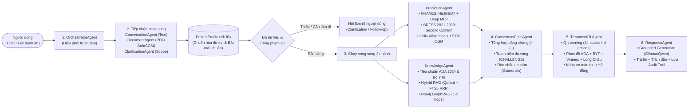

# Hệ Thống Đa Tác Tử Sàng Lọc & Hội Chẩn Đái Tháo Đường (`MultiAgent`)

Hệ thống hỗ trợ quyết định lâm sàng đa tác tử (**Multi-Agent Clinical Decision Support System**) cho bài toán sàng lọc, phân tầng nguy cơ và cá thể hóa lộ trình can thiệp đái tháo đường típ 2 tại Việt Nam. Hệ thống kết hợp:
- **9 Tác tử thông minh (Agents)** giao tiếp qua `MessageBus` có cơ chế **tranh biện đa vòng `(+/-)`** và **Rào chắn an toàn (Safety Guardrails)**.
- **Đa mô hình Học máy & Học sâu (`/notebook/model`)**: Ensemble `HistGradientBoosting` + `Deep MLP` trên tập lâm sàng **CDC NHANES** và tập cộng đồng **CDC BRFSS 2021–2023 (120.000 mẫu sạch)**, kết hợp **ResNet-18 + Grad-CAM** (phân độ võng mạc), **LSTM** (dự báo đường huyết liên tục CGM) và **Q-Learning RL** (tối ưu lộ trình điều trị).
- **Hybrid RAG & Neo4j GraphRAG**: Kết hợp tìm kiếm ngữ nghĩa (**Qdrant**), tìm kiếm toàn văn tiếng Việt (**SQLite FTS5 BM25**) và duyệt đồ thị tri thức y khoa (**Neo4j**) từ 4 nguồn chuẩn: **ADA Standards of Care 2024**, **Bộ Y tế Việt Nam (QĐ 5481/QĐ-BYT)**, **Hệ thống Y tế Vinmec**, và **Dược điển Nhà thuốc FPT Long Châu**.
- **LLM Nội bộ Ổn định**: Vận hành hoàn toàn với **Ollama (`qwen2.5:3b` / `qwen2.5:1.5b`)** hoặc **Local HuggingFace (`Qwen2.5-1.5B-Instruct`)** kèm nhánh dự phòng xác định bằng luật (**Deterministic Rule Fallback**) ở mọi tác tử.

---

## 1. Cấu Trúc Thư Mục Chuẩn Hóa

```text
MultiAgent/
├── app.py                   # Entrypoint FastAPI kết hợp phục vụ giao diện Web & REST/Streaming API
├── docker-compose.yml       # Hạ tầng container: Neo4j (7687), Qdrant (6333), SeaweedFS S3 (8333)
├── requirements.txt         # Danh sách thư viện Python
├── docs/                    # Báo cáo LaTeX & tài liệu thiết kế hệ thống (Project 01)
├── data/                    # Dữ liệu dự án (xem chi tiết tại data/README.md)
│   ├── download/            # Dữ liệu gốc chưa qua chỉnh sửa (ada, bo_y_te_vn, nhanes, brfss, vinmec, long_chau)
│   └── output/              # Dữ liệu sạch sau xử lý (datasets/, kb/, storage/)
├── notebook/                # 10 Jupyter Notebooks đã thực thi (00: Tiền xử lý, 01–08: Train ML/DL/RL, 09: Đánh giá)
│   └── model/               # 11 model artifacts (.joblib, .pt, .npz) + evaluation_leaderboard.csv
├── scripts/                 # Các script CLI độc lập (crawl dữ liệu, nạp KB, huấn luyện, chat CLI)
├── src/                     # Lõi xử lý Multi-Agent, RAG/GraphRAG, ML/DL/RL & API (xem chi tiết tại src/README.md)
├── test/                    # Bộ kiểm thử tự động Pytest (46 test cases)
└── web/                     # Giao diện người dùng React + Vite (Phòng hội chẩn trực quan hóa đa tác tử & đồ thị)
```

> 📌 **Tài liệu chuyên sâu từng phân hệ**:
> - Chi tiết về **6 bộ dữ liệu, lý do lựa chọn và link gốc đã kiểm chứng**: xem [`data/README.md`](./data/README.md).
> - Chi tiết về **kiến trúc từng gói trong `/src` và giải thích sâu 6 giai đoạn hội chẩn**: xem [`src/README.md`](./src/README.md).

---

## 2. Luồng Hoạt Động Của Hệ Thống (System Workflow)



### Tóm tắt 6 bước xử lý một lượt hội chẩn:
1. **Tiếp nhận & Bóc tách đa phương thức (`ConversationAgent` + `DocumentAgent`)**:
   - Đọc tin nhắn tự do và các tệp đính kèm (PDF phiếu xét nghiệm, ảnh chụp bệnh án, DOCX, CSV chuỗi đường huyết).
   - Kết hợp **LLM Structured Output (Ollama / Qwen)** với **Bộ luật Regex y khoa** (`lab_extractor.py`) và tự động quy đổi đơn vị (`mmol/L → mg/dL`, `m → cm`).
   - Cập nhật vào `PatientProfile` tích lũy của phiên và tự động đánh dấu nếu có sự mâu thuẫn số liệu giữa các nguồn.
2. **Kiểm tra Phạm vi & Làm rõ (`ClarificationAgent`)**:
   - Phát hiện các trường hợp ngoại lệ (phụ nữ mang thai, trẻ em `< 18 tuổi`, thiếu máu làm sai lệch HbA1c, glucose chưa rõ đo lúc đói hay bất kỳ) hoặc thiếu thông tin cốt lõi (`Tuổi`, `BMI`) để hỏi lại người dùng trước khi kết luận.
3. **Phân tích Chuyên môn Song song (`PredictionAgent` ‖ `KnowledgeAgent`)**:
   - **`PredictionAgent`**: Chạy tổ hợp mô hình học máy `HistGBDT` + học sâu `Deep MLP` trên tập lâm sàng **NHANES**, đối chiếu chéo với mô hình quy mô lớn **BRFSS 2021–2023 (120.000 mẫu sạch)**, phân tích ảnh đáy mắt bằng **ResNet-18 + Grad-CAM** (nếu có ảnh) và dự báo đường huyết 15–60 phút bằng **LSTM** (nếu có chuỗi CGM).
   - **`KnowledgeAgent`**: Đối chiếu ngưỡng chẩn đoán **ADA 2024 / Bộ Y tế QĐ 5481/QĐ-BYT**, truy xuất văn bản bằng **Hybrid RRF (Qdrant Vector + SQLite FTS5 BM25)** và duyệt đồ thị tri thức **Neo4j GraphRAG** (41 nút, 47 cạnh) từ các yếu tố nguy cơ của bệnh nhân.
4. **Hội đồng Tranh biện Đa vòng & Rào chắn An toàn (`ConsensusCriticAgent`)**:
   - Đối chiếu kết quả giữa các mô hình và xét nghiệm để lập danh sách bằng chứng đồng thuận **`[+]`** và điểm mâu thuẫn **`[-]`**.
   - Nếu phát hiện bất đồng (ví dụ: *ML báo nguy cơ cao nhưng xét nghiệm bình thường*, *ML và DL lệch nhau ≥ 15%*, *NHANES và BRFSS ngược chiều*, hoặc *mới có 1 xét nghiệm vượt ngưỡng cần xác nhận lần 2*), `ConsensusCriticAgent` phát thông điệp **`CHALLENGE`** qua `MessageBus` buộc `PredictionAgent` và `KnowledgeAgent` giải trình/điều chỉnh độ tin cậy.
   - Kiểm tra **Safety Guardrails** (cấp cứu tăng áp lực thẩm thấu khi `Glucose ≥ 600 mg/dL`, tăng đường huyết nặng `≥ 300 mg/dL` hoặc `HbA1c ≥ 10%`, hạ đường huyết `< 54 mg/dL`).
5. **Đề xuất Lộ trình Can thiệp Học tăng cường (`TreatmentRLAgent`)**:
   - Ánh xạ trạng thái bệnh nhân vào bảng $Q^*(s, a)$ (`rl_qtable.npz`) kết hợp phác đồ cá thể hóa 4 trục của **ADA 2024 – Bộ Y tế – Vinmec** và thông tin thuốc tham chiếu từ **Nhà thuốc FPT Long Châu** (*Glucophage, Forxiga, Jardiance, Januvia, Trajenta, Diamicron MR, Lantus SoloStar*).
   - Bị khóa an toàn bởi kết luận của Hội đồng (không gợi ý thuốc kê đơn khi chưa đủ tiêu chí chẩn đoán xác định) và cảnh báo chống chỉ định suy thận (`eGFR < 30`) từ đồ thị Neo4j.
6. **Tổng hợp Phản hồi & Lưu vết (`ResponseAgent`)**:
   - Sinh câu trả lời tiếng Việt dễ hiểu, bám sát 100% vào dữ liệu JSON của hội đồng (**Grounded Generation**), đính kèm trích dẫn nguồn và phát luồng sự kiện thời gian thực (NDJSON) lên giao diện Web.

---

## 3. Hướng Dẫn Khởi Chạy Nhanh

### Bước 1: Khởi động các dịch vụ lưu trữ (Neo4j, Qdrant, SeaweedFS)
```bash
docker compose up -d neo4j qdrant seaweedfs
```

### Bước 2: Cài đặt môi trường & Nạp cơ sở tri thức (nếu chạy lần đầu)
```bash
.venv/bin/pip install -r requirements.txt
.venv/bin/python scripts/crawl_longchau_vinmec.py
.venv/bin/python scripts/ingest_kb.py
```

### Bước 3: Chạy máy chủ Backend & Giao diện Web
```bash
.venv/bin/uvicorn app:app --host 0.0.0.0 --port 8000 --reload
```
- Giao diện Web / API Docs: `http://localhost:8000` (`http://localhost:8000/docs`)

### Bước 4: Chạy bộ kiểm thử tự động
```bash
.venv/bin/pytest test/ -q
```
