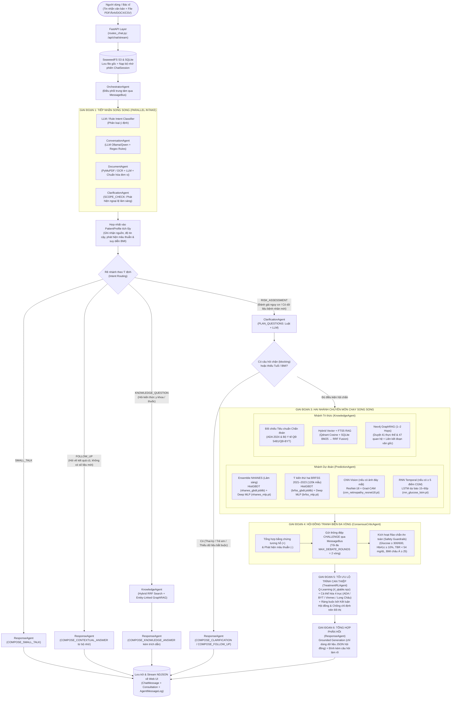

# Kiến Trúc & Luồng Hoạt Động Của Hệ Thống (`MultiAgent/src`)

Thư mục `src/` chứa toàn bộ lõi xử lý phía dưới (Backend API, Hệ thống 9 Tác tử thông minh, Giao thức `MessageBus`, Các mô hình ML/DL/RL, Cơ sở tri thức Hybrid Vector + Neo4j GraphRAG, và Tầng lưu trữ đa phương thức).

---

## 1. Cấu trúc chuẩn hóa của `/src`

```text
src/
├── config.py                        # Cấu hình trung tâm (Ollama/Qwen local, SQLite, Qdrant, Neo4j, SeaweedFS)
├── schemas/
│   └── patient_profile.py           # Schema hồ sơ bệnh nhân tích lũy qua nhiều lượt chat, tự động phát hiện mâu thuẫn nguồn
├── communication/
│   ├── message_bus.py               # Bus thông điệp bất đồng bộ kiểu FIPA-ACL (REQUEST, INFORM, CHALLENGE, RESPONSE, FAILURE)
│   └── summary.py                   # Bộ tóm tắt 1 dòng cho từng thông điệp để hiển thị trực tiếp lên Phòng hội chẩn
├── llm/
│   ├── client.py                    # Lớp trừu tượng LLM: Ollama HTTP API (qwen2.5:3b) + Fallback Qwen2.5-1.5B-Instruct Local
│   └── prompts.py                   # Hệ thống Prompt & Pydantic Schema ép kiểu JSON (Intent, Extraction, Scope, Grounded Response)
├── document_processing/
│   ├── loaders.py                   # Bộ đọc đa định dạng: PDF văn bản, PDF scan, ảnh phiếu xét nghiệm, DOCX, CSV chuỗi CGM
│   ├── lab_extractor.py             # Bộ trích xuất Regex + Luật y khoa song ngữ Việt–Anh
│   └── unit_normalizer.py           # Chuẩn hóa đơn vị xét nghiệm (mmol/L ↔ mg/dL, m ↔ cm, phát hiện đơn vị ngầm định)
├── models/
│   ├── datasets.py                  # Đặc tả dữ liệu NHANES 2011–2018, BRFSS 2021–2023 (120k mẫu sạch) & Mask Augmentation
│   ├── tabular_ml.py                # Mô hình ML: HistGradientBoosting + Platt Scaling + Giải thích Feature Occlusion
│   ├── deep_mlp.py                  # Mô hình DL bảng: PyTorch Deep MLP + BatchNorm/Dropout + Temperature Scaling
│   ├── cnn_vision.py                # Mô hình Vision DL: ResNet-18 phân độ võng mạc ICDR 0–4 + Bản đồ nhiệt Grad-CAM
│   ├── rnn_temporal.py              # Mô hình Temporal DL: LSTM dự báo chuỗi CGM (+15/+30/+45/+60 phút) & chỉ số TIR/TAR/TBR
│   └── qlearning_treatment.py       # Mô hình RL: Q-Learning 24 trạng thái × 4 bậc phác đồ (ADA 2024 + BYT + Vinmec + Long Châu)
├── knowledge/
│   ├── clinical_criteria.py         # Đối chiếu ngưỡng chẩn đoán ADA 2024 / QĐ 5481/QĐ-BYT & Ánh xạ hồ sơ sang nút đồ thị
│   ├── scope.py                     # Kiểm tra phạm vi lâm sàng (thai kỳ, trẻ em, thiếu máu/HbA1c sai lệch, mâu thuẫn số liệu)
│   ├── entity_linking.py            # Liên kết thực thể tiếng Việt không dấu từ câu hỏi tự do vào 41 nút đồ thị Neo4j
│   ├── embedder.py                  # Embedding đa ngôn ngữ 384 chiều (FastEmbed ONNX + HashingEmbedder dự phòng offline)
│   └── ingest.py                    # Pipeline nạp tài liệu Markdown/PDF/HTML vào SeaweedFS, SQLite FTS5, Qdrant và Neo4j
├── storage/
│   ├── db.py                        # Kết nối SQLAlchemy 2 (SQLite WAL + FTS5 full-text index mặc định; tùy chọn PostgreSQL)
│   ├── models.py                    # ORM: ChatSession, ChatMessage, AgentMessageLog, Document, Consultation, KbDocument, KbChunk
│   ├── vector_store.py              # Hybrid Search = Qdrant Vector Search + SQLite FTS5 BM25 gộp bằng Reciprocal Rank Fusion (RRF)
│   ├── graph_store.py               # Neo4j Knowledge Graph (Cypher 1–2 hops, gắn chunk_ids về đoạn văn gốc)
│   └── object_storage.py            # Lưu trữ file bệnh án & tài liệu KB qua SeaweedFS (S3 API) hoặc đĩa cục bộ
├── agents/
│   ├── orchestrator.py              # Tác tử Điều phối Trung tâm (OrchestratorAgent)
│   ├── conversation_agent.py        # Tác tử Bóc tách Hội thoại (ConversationAgent)
│   ├── document_agent.py            # Tác tử Đọc Bệnh án Đa phương thức (DocumentAgent)
│   ├── clarification_agent.py       # Tác tử Kiểm tra Phạm vi & Hỏi làm rõ (ClarificationAgent)
│   ├── prediction_agent.py          # Tác tử Dự đoán Đa mô hình ML + DL + CNN + RNN (PredictionAgent)
│   ├── knowledge_agent.py           # Tác tử Tri thức Y khoa Hybrid RAG + GraphRAG (KnowledgeAgent)
│   ├── consensus_critic_agent.py    # Tác tử Hội chẩn & Phản biện Đa vòng +/- (ConsensusCriticAgent)
│   ├── treatment_rl_agent.py        # Tác tử Đề xuất Lộ trình Can thiệp Học tăng cường (TreatmentRLAgent)
│   └── response_agent.py            # Tác tử Tổng hợp Câu trả lời Tiếng Việt Có Kiểm chứng (ResponseAgent)
└── api/
    ├── deps.py                      # Khởi tạo Singleton Orchestrator & Chuyển đổi DTO
    ├── routes_chat.py               # API Chat đồng bộ (/api/chat) & Streaming thời gian thực NDJSON (/api/chat/stream)
    ├── routes_session.py            # API Quản lý phiên trò chuyện, lịch sử hội chẩn & phản hồi người dùng
    └── routes_system.py             # API Trạng thái hệ thống, Thống kê KB, Form hội chẩn trực tiếp & Q-Table
```

---

## 2. Sơ Đồ Luồng Hoạt Động Tổng Thể (End-to-End System Workflow)



---

## 3. Chi Tiết 6 Giai Đoạn Trong Luồng Hoạt Động

### Giai đoạn 1: Tiếp nhận Đa phương thức & Hợp nhất Hồ sơ (`Parallel Intake & Profile Merge`)
Khi người dùng gửi tin nhắn văn bản và/hoặc đính kèm tệp bệnh án qua `/api/chat` hoặc `/api/chat/stream`:
1. **Lưu trữ nguyên bản**: Các file tải lên được tính băm `SHA-256` (chống trùng lặp trong cùng phiên) và lưu lên **SeaweedFS (S3)** tại bucket `astarcare-uploads`.
2. **4 tác vụ chạy bất đồng bộ song song (`asyncio.gather`)**:
   - **`Orchestrator._classify`**: Phân loại ý định người dùng dựa trên lịch sử hội thoại và hồ sơ hiện có.
   - **`ConversationAgent` (`EXTRACT_FROM_TEXT`)**: Kết hợp **LLM Structured Output** (Ollama `qwen2.5:3b` / Qwen local) với **Regex Extractor** (`lab_extractor.py`). Nếu LLM bỏ sót trường nào, bộ luật regex tự động bù khuyết (`method = "llm+rules"`). Đồng thời tự động chuẩn hóa đơn vị (`unit_normalizer.py`: đổi `mmol/L → mg/dL` nhân `18.0182`, đổi chiều cao `m → cm`).
   - **`DocumentAgent` (`PARSE_DOCUMENT`)**: Đọc PDF văn bản (`PyMuPDF`), PDF scan / ảnh chụp phiếu xét nghiệm (`Tesseract OCR` hoặc `Vision LLM`), file Word (`python-docx`) hoặc file CSV chuỗi đường huyết liên tục (CGM).
   - **`ClarificationAgent` (`SCOPE_CHECK`)**: Kiểm tra xem người dùng có nhắc tới các tình huống ngoài phạm vi sàng lọc chuẩn (như đang mang thai, trẻ em, đang dùng thuốc hạ đường huyết, thiếu máu/bệnh huyết sắc tố làm sai lệch HbA1c) hay không.
3. **Hợp nhất vào `PatientProfile` tích lũy**:
   - Hồ sơ bệnh nhân được giữ xuyên suốt phiên trò chuyện (`ChatSession.profile`).
   - Dữ liệu từ file được nạp trước, lời người dùng nói trực tiếp trong tin nhắn được nạp sau (để người dùng có thể đính chính thông tin). Nếu phát hiện hai nguồn cho giá trị chênh lệch lớn (ví dụ tuổi trong file là 45 nhưng tin nhắn gõ 62, hoặc glucose lệch `> 15 mg/dL`), `PatientProfile` tự động ghi nhận vào danh sách `conflicts` để Hội đồng và Tác tử Làm rõ xử lý.

---

### Giai đoạn 2: Định tuyến Ý định & Kiểm tra Làm rõ (`Intent Routing & Clarification Gate`)
Sau khi cập nhật `PatientProfile`, `OrchestratorAgent` quyết định luồng đi tiếp theo:
- **`SMALL_TALK`**: Chào hỏi xã giao → chuyển thẳng cho `ResponseAgent` trả lời ngắn gọn.
- **`FOLLOW_UP`**: Người dùng hỏi tiếp về kết quả vừa đánh giá (ví dụ: *"Tại sao nguy cơ của tôi lại cao?"*, *"BMI của tôi bao nhiêu?"*) mà không cung cấp chỉ số mới → `ResponseAgent` truy xuất trực tiếp từ bộ nhớ phiên (`profile` + `last_assessment` + `history`), không cần chạy lại toàn bộ hội đồng.
- **`KNOWLEDGE_QUESTION`**: Câu hỏi kiến thức y khoa thuần túy (ví dụ: *"Thuốc Forxiga 10mg dùng khi nào?"*, *"Tiêu chuẩn chẩn đoán đái tháo đường của Bộ Y tế là gì?"*) → chuyển cho `KnowledgeAgent` chạy kết hợp **Hybrid Search (Qdrant + SQLite FTS5)** và **Entity-Linked GraphRAG (Neo4j)** rồi tổng hợp câu trả lời có trích dẫn.
- **`RISK_ASSESSMENT`**: Khi có dữ liệu bệnh nhân mới hoặc yêu cầu đánh giá nguy cơ:
  - `ClarificationAgent` (`PLAN_QUESTIONS`) kiểm tra các câu hỏi cần làm rõ.
  - Nếu có câu hỏi mang tính **chặn luồng (`blocking = True`)** (ví dụ: nghi ngờ đái tháo đường thai kỳ hoặc trẻ em `< 18 tuổi`) hoặc chưa đủ 2 thông tin tối thiểu (`age_years` và `bmi`), hệ thống dừng lại để hỏi người dùng trước khi chạy mô hình.

---

### Giai đoạn 3: Hai Nhánh Chuyên Môn Chạy Song Song (`PredictionAgent ‖ KnowledgeAgent`)
Khi hồ sơ đã sẵn sàng (`profile.is_ready()`), `OrchestratorAgent` kích hoạt đồng thời hai nhánh độc lập:

1. **Nhánh Dự đoán Dữ liệu (`PredictionAgent` — `PREDICT_RISK`)**:
   - **Ensemble Lâm sàng Chính (CDC NHANES)**: Chạy song song mô hình **HistGradientBoosting đã hiệu chỉnh xác suất Platt Scaling** (`nhanes_gbdt.joblib`) và **Deep MLP PyTorch** (`nhanes_mlp.pt`). Tính xác suất trung bình, nguy cơ tương đối (`relative_risk`) so với tỷ lệ nền quần thể, độ bất đồng giữa 2 mô hình (`disagreement`), và giải thích mức đóng góp từng đặc trưng bằng **Feature Occlusion** (`top_risk_factors`).
   - **Ý kiến Thứ hai Quy mô lớn (CDC BRFSS 2021–2023 — 120.000 mẫu sạch)**: Chạy cặp mô hình `brfss_gbdt.joblib` và `brfss_mlp.pt` để đối chiếu nguy cơ tương đối trên quần thể khảo sát cộng đồng gần đây.
   - **Phân tích Ảnh đáy mắt (`CNNRetinopathyEngine`)**: Nếu hồ sơ có ảnh đáy mắt, chạy mô hình `cnn_retinopathy_resnet18.pt` phân độ bệnh võng mạc đái tháo đường theo thang ICDR (0–4) và sinh bản đồ nhiệt **Grad-CAM**.
   - **Dự báo Chuỗi đường huyết CGM (`RNNTemporalEngine`)**: Nếu hồ sơ có chuỗi đo glucose (`≥ 5 điểm`), tính các chỉ số đồng thuận quốc tế (`TIR 70–180 mg/dL`, `TAR > 180`, `TBR < 70`, `CV%`, `eAG/HbA1c ước tính`) và nếu `≥ 12 điểm` thì chạy mô hình **LSTM** (`rnn_glucose_lstm.pt`) dự báo đường huyết ở `+15, +30, +45, +60 phút`.

2. **Nhánh Tri thức Lâm sàng (`KnowledgeAgent` — `RETRIEVE_EVIDENCE`)**:
   - **Đối chiếu Tiêu chuẩn Chẩn đoán (`evaluate_glycemia`)**: So sánh `FPG`, `HbA1c`, `OGTT 2h`, `Glucose bất kỳ` với ngưỡng chuẩn của **ADA 2024 & Bộ Y tế QĐ 5481/QĐ-BYT** và kiểm tra quy tắc *"cần ≥ 2 xét nghiệm bất thường để chẩn đoán xác định khi chưa có triệu chứng tăng đường huyết cấp tính"*.
   - **Neo4j GraphRAG (`_graph`)**: Ánh xạ tình trạng bệnh nhân thành các nút xuất phát trên đồ thị Neo4j (ví dụ: `Đái tháo đường típ 2`, `Thừa cân/béo phì`, `Tăng huyết áp`, `Suy thận nặng (eGFR < 30)`), duyệt lân cận 1–2 bước (`max_hops=2`) qua 47 cạnh quan hệ (`HAS_RISK_FACTOR`, `DIAGNOSED_BY`, `CAUSES`, `SCREENED_BY`, `TREATED_BY`, `CONTRAINDICATED_IN`, `PREVENTED_BY`) và thu thập các `chunk_ids` gắn trên cạnh.
   - **Hybrid Vector + Full-Text RAG (`_search`)**: Nhúng câu truy vấn bằng `FastEmbed` (384 chiều), tìm kiếm song song trên **Qdrant** (Cosine Similarity) và **SQLite FTS5** (BM25 bỏ dấu tiếng Việt), sau đó hợp nhất thứ hạng bằng **Reciprocal Rank Fusion (RRF, $k=60$)** và gộp với các đoạn văn liên kết từ đồ thị Neo4j.

---

### Giai đoạn 4: Hội Đồng Tranh Biện Đa Vòng (`ConsensusCriticAgent` — `DELIBERATE`)
Đây là cơ chế kiểm chứng chéo trung tâm của hệ thống. `ConsensusCriticAgent` nhận kết quả từ cả hai nhánh, tổng hợp bằng chứng thuận chiều **`[+]`**, phát hiện các mâu thuẫn **`[-]`** và chủ động gửi thông điệp **`CHALLENGE`** qua `MessageBus` tới các tác tử liên quan (tối đa `MAX_DEBATE_ROUNDS = 2` vòng):

| Mã Vấn Đề (`issue_id`) | Điều kiện kích hoạt | Tác tử bị chất vấn (`CHALLENGE`) | Cách phân xử của Hội đồng |
| :--- | :--- | :--- | :--- |
| `data_quality` | Độ đầy đủ đặc trưng `< 35%` | `PredictionAgent` (`CHALLENGE_DATA_QUALITY`) | Hạ độ tin cậy mô hình (`ml_confidence`), ghi nhận các đặc trưng đang khuyết thiếu. |
| `ml_dl_disagree` | Độ lệch xác suất giữa HistGBDT và Deep MLP `≥ 15%` | `PredictionAgent` (`CHALLENGE_MODEL_DISAGREEMENT`) | Yêu cầu giải trình đặc trưng gây lệch giữa ML và DL; dùng xác suất trung bình và hạ độ tin cậy. |
| `cohort_disagree` | Mô hình lâm sàng (NHANES) và mô hình cộng đồng (BRFSS 2021–2023) cho nguy cơ tương đối ngược chiều nhau (`≥ 1.5x` vs `≤ 0.8x`) | `PredictionAgent` (`CHALLENGE_COHORT_DISAGREEMENT`) | Giải thích sự khác biệt giữa nhãn xét nghiệm máu (NHANES) và nhãn tự khai (BRFSS); ưu tiên mô hình chính và đề nghị xét nghiệm máu phân xử. |
| `ml_high_labs_normal` | Mô hình ML/DL báo nguy cơ cao (`≥ 30%`) nhưng xét nghiệm máu hiện tại bình thường | **Vòng 1**: `PredictionAgent` (`CHALLENGE_ML_VS_LABS`)<br/>**Vòng 2**: `KnowledgeAgent` (`CHALLENGE_SCREENING_PLAN`) | **Vòng 1**: `PredictionAgent` nhượng bộ chẩn đoán hiện tại cho xét nghiệm nhưng bảo lưu cảnh báo nguy cơ tiến triển dài hạn.<br/>**Vòng 2**: Hội đồng chất vấn tiếp `KnowledgeAgent` để lập lịch tầm soát định kỳ (mỗi 1–3 năm) và can thiệp lối sống. |
| `ml_low_labs_diabetic` | Mô hình ML/DL báo nguy cơ thấp (`< 15%`) nhưng xét nghiệm máu đã vượt ngưỡng đái tháo đường | `PredictionAgent` (`CHALLENGE_ML_VS_LABS`) | `PredictionAgent` rút lại nhận định nguy cơ thấp vì xét nghiệm máu là tiêu chuẩn vàng. |
| `verify_diagnostic_criteria` | Xét nghiệm nằm trong ngưỡng đái tháo đường (`diabetes_range`) | `KnowledgeAgent` (`CHALLENGE_VERIFY_CRITERIA`) | Kiểm tra xem đã đủ 2 tiêu chí xét nghiệm bất thường theo ADA 2024 / Bộ Y tế chưa, hay cần làm lại xét nghiệm lần 2 để xác nhận. |

Cuối cùng, `ConsensusCriticAgent` chạy bộ **Rào chắn An toàn (`Safety Guardrails`)** có quyền ưu tiên tuyệt đối:
- `Glucose ≥ 600 mg/dL` → Cảnh báo cấp cứu (`emergency`: nguy cơ tăng áp lực thẩm thấu máu).
- `Glucose ≥ 300 mg/dL` hoặc `HbA1c ≥ 10%` → Cảnh báo khẩn (`urgent`: cần khám chuyên khoa Nội tiết sớm, cân nhắc Insulin).
- Chuỗi CGM có điểm `< 54 mg/dL` → Cảnh báo hạ đường huyết mức 2 (`urgent`).
- Tổ hợp **Béo phì châu Á (`BMI ≥ 25`) + Tăng huyết áp + Tiền sử gia đình/Bệnh tim mạch** → Cảnh báo nhóm nguy cơ đỏ (`priority`).

---

### Giai đoạn 5: Tối Ưu Hóa Lộ Trình Can Thiệp Bằng Học Tăng Cường (`TreatmentRLAgent`)
Sau khi có kết luận của Hội đồng:
1. **Mã hóa Trạng thái MDP ($s \in \{0..23\}$)**: Từ mức đường huyết (`FPG`, `eAG` từ `HbA1c`, hoặc trung bình chuỗi CGM), chỉ số `BMI` theo ngưỡng châu Á (`< 23`, `23–25`, `≥ 25`) và bệnh đồng mắc (`Tăng huyết áp`, `Bệnh tim mạch/Đột quỵ`).
2. **Tra cứu Chính sách Tối ưu $Q^*(s, a)$**: Chọn hành động $a^* = \arg\max_a Q^*(s, a)$ trên 4 bậc phác đồ:
   - **Bậc 0 (`A0`)**: Can thiệp lối sống tích cực (Dinh dưỡng GI thấp + Vận động 150 phút/tuần + Giảm 5–7% cân nặng).
   - **Bậc 1 (`A1`)**: Khởi trị đơn trị liệu bước 1 (Tham chiếu **Metformin / Glucophage 500–850mg**; hoặc **DPP-4i Trajenta 5mg / Januvia 100mg** khi chống chỉ định thận).
   - **Bậc 2 (`A2`)**: Phác đồ phối hợp kép bảo vệ Tim–Thận & Kiểm soát cân nặng (Tham chiếu **Metformin + SGLT2i Forxiga 10mg / Jardiance 25mg** hoặc **GLP-1 RA**).
   - **Bậc 3 (`A3`)**: Thăm khám Chuyên khoa Nội tiết khẩn & Đánh giá phác đồ tích cực / **Insulin nền (Lantus SoloStar)**.
3. **Ràng buộc An toàn Lâm sàng (Consensus Override & Contraindication Check)**:
   - Nếu Hội đồng kết luận chưa mắc đái tháo đường hoặc mới có 1 xét nghiệm bất thường chưa xác nhận (`confirmation_required = True`), `TreatmentRLAgent` tự động khóa hành động ở **Bậc 0 (Can thiệp lối sống & Xét nghiệm xác nhận)**, không đề xuất dùng thuốc sớm.
   - Nếu `Safety Guardrail` mức `emergency/urgent` kích hoạt → tự động nâng lên **Bậc 3 (`A3`)**.
   - Đính kèm tự động các cảnh báo chống chỉ định từ đồ thị tri thức Neo4j (ví dụ: *Metformin chống chỉ định khi suy thận nặng eGFR < 30 mL/phút/1,73 m²; lưu ý giảm hấp thu Vitamin B12; cảnh báo hạ đường huyết của nhóm Sulfonylurea Diamicron MR ở người ≥ 65 tuổi*).

---

### Giai đoạn 6: Tổng Hợp Phản Hồi Có Kiểm Chứng & Lưu Vết (`ResponseAgent` & `Audit Trail`)
1. **Grounded Generation (`ResponseAgent`)**:
   - Đóng gói toàn bộ JSON kết quả hội đồng (`consensus`, `prediction`, `knowledge`, `treatment`, `citations`) gửi vào LLM (`Ollama` / `Qwen`) với ràng buộc nghiêm ngặt: **chỉ được diễn đạt các con số và bằng chứng có trong JSON đầu vào, tuyệt đối không tự bịa số liệu hay tên thuốc ngoài danh mục**.
   - Nếu LLM tắt hoặc không khả dụng, hệ thống tự động kết xuất bằng mẫu báo cáo Markdown chuẩn hóa (`_assessment_template`).
   - Các câu hỏi làm rõ còn lại (`questions`) được nối nguyên văn vào cuối câu trả lời để thu thập thêm thông tin cho lượt chat kế tiếp.
2. **Streaming Thời gian thực & Lưu vết Kiểm toán (`Audit Trail`)**:
   - Qua endpoint `/api/chat/stream`, từng thông điệp giao tiếp giữa các tác tử trên `MessageBus` và phần đồ thị tri thức vừa duyệt được đẩy trực tiếp (NDJSON) lên giao diện **"Phòng hội chẩn"** ngay khi vừa xảy ra.
   - Kết thúc lượt chat, toàn bộ hồ sơ cập nhật, lịch sử tin nhắn, bản ghi hội chẩn (`Consultation`) và toàn bộ nhật ký thông điệp nội bộ (`AgentMessageLog`) được lưu bền vững vào SQLite (`data/output/storage/multiagent.db`).
